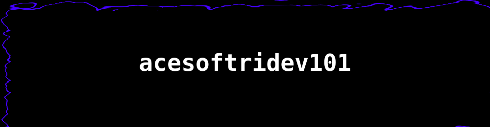
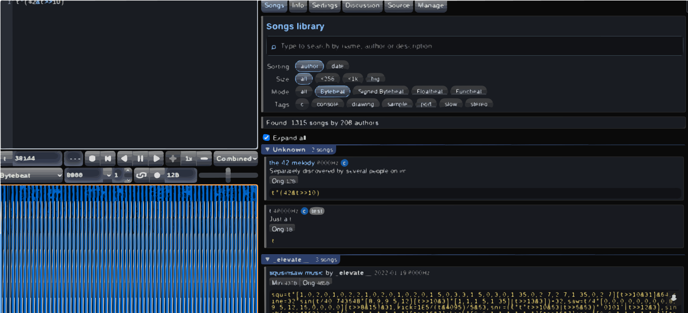

## Hi there I am acesoftridev101, I prefer you call me the ace.

<!-- Layered PNG Background Banner -->

  
  
  
  
  

 

<!-- Two-Column Layout for Bio and Stats -->
<table width="100%">
  <tr>
    <td width="50%" valign="top">
      <h3>⚡ About Me</h3>
      <ul>
        <li>🔭 Not really working on any projects rn bruh.</li>
        <li>🌱 Learning new frameworks and tools</li>
        <li>💬 Ask me about batch, c++, HTMl, OR Assembly. Or don't ask me anything, but if you need you can tell me , and remember you can use ai and nobody will notice.</li>
        <li>I made the operating system called "ArtsaOs." Since the name AstraOs was took i reversed Astra and made Artsa. That's why its named ArtsaOs.</li>
        <li>I had an account on a different platform. I forgot what it's called but when I was posting another file I got flagged for life. That's why I'm here on GitHub.</li>
      </ul>
    </td>

